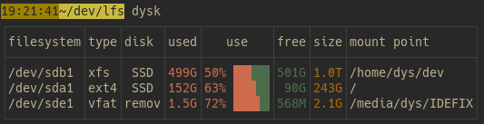
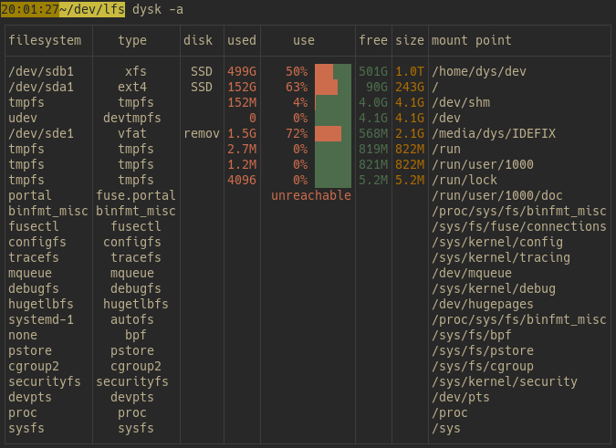
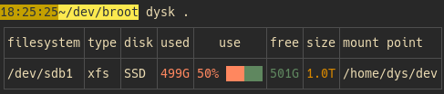
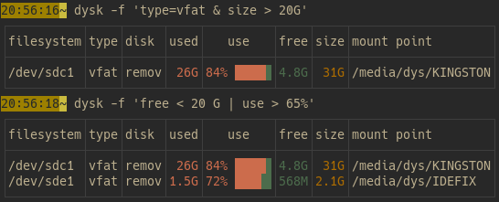

There are several ways to choose the filesystems of either the table or the JSON output:

* [Choose between the "normal" ones or all of them](#normality)
* [Select the filesystem containing a specific path](#current-filesystem)
* [Use the rich query syntax of the `--filter` argument](#filter-argument)

# Normality

The default selection of filesystems showcases your storage: it leaves out virtual filesystems, bound mounts, and other filesystems with no underlying disk, except remote ones.



More precisely, a filesystem is listed by default when all these conditions hold:

* its usage statistics could be read, or it's unreachable (eg a remote one whose server is down)
* it has an underlying disk, or it's remote, or it's of type `zfs`
* its disk isn't a disk image
* it isn't bound to another filesystem
* it isn't of type `squashfs`
* (on mac) it isn't the read-only system volume mounted on `/`, and isn't mounted in `/System` (except `/System/Volumes/Data`) or in `/Library/Developer`

Usage statistics may also be missing because they were [skipped or took too long](../table#remote-filesystems).

To see *all* filesystems of your system, do `dysk --all`:



This list can be quite big with virtual file systems, docker use, etc.

# Current filesystem

If you're only interested in the device on which some file is, give the path as argument.

For example, for the current device, use `dysk .`:



This filesystem is shown even when it isn't a "normal" one. Bound mounts of the same device are only shown with `-a`.

# Filter argument

The `--filter` argument, shortened in `-f`, lets you specify a constraint, or combine several ones.

A constraint can be related to any [column](../table#all-columns).

You can for example fetch the filesystems with a given type with `dysk -f 'type=xfs'`.

Or remote volumes with `dysk -f 'remote=true'`.

The operators you can apply to a column are the following ones:

|operator|meaning|
|-|-|
|<| lower
|<=| lower or equal
|>| greater
|>=| greater or equal
|<>| different
|=| on text columns, contains, ignoring case - for example `fs=sda` matches `/dev/sda1`; on other columns, equal
|==|really equal

The value is read according to the column:

* sizes (`size`, `used`, `free`) and counts (`inodes_free`, etc.) take a number, optionally with a unit: `100G`, `4kB`, `1.5T`. Add `i` for 1024-based units, eg `54GiB`
* shares (`use`, `use_percent`, `free_percent`, `inodes`, `inodes_use_percent`, etc.) take a percentage like `65%`, or a fraction like `0.65`
* booleans (`remote`) take `true` or `false`, `yes` or `no`, `1` or `0`

You can combine several column conditions with boolean operators `|` (or), `&` (and) and `!` (not) and if needed you can use parenthesis.

For example you may want to select the volumes with not enough space with

```bash
dysk -f 'free<100G | use>65%'
```

Examples:



**Note:**
Only *normal* filesystems are shown unless you use `-a`. This applies even when you use the `--filter` argument.

