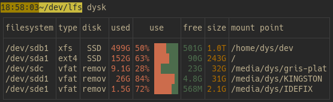
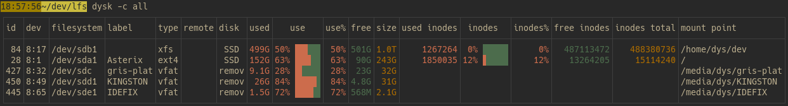
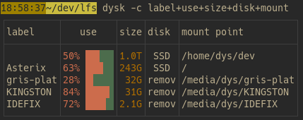
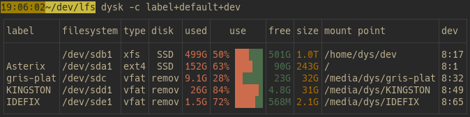
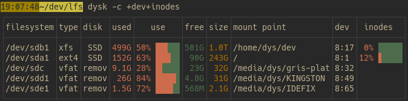
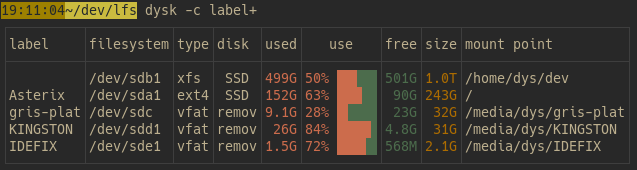
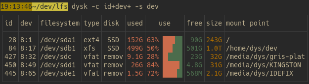
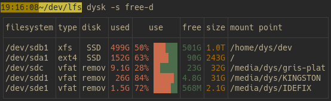
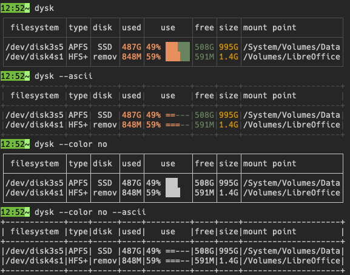
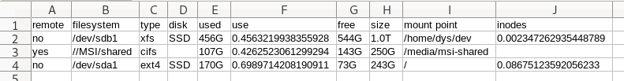

The standard output of dysk is a table with a default set of columns and only the "normal looking" filesystems.
You can modify it easily.

# Columns

You can run `dysk --list-cols` for the list of all columns, with their aliases (eg `ifree` for `inodes_free`).

## All columns

name | default | meaning
-|-|-
id | | mount point id
dev | | device id
filesystem | ✓ | filesystem
label |  | label
type | ✓ | filesystem type
remote | | whether it's a remote filesystem
disk | ✓ | short tag of the underlying storage identified
used | ✓ | cumulated size of the occupied blocks
use | ✓ | graphical view of the use share
use_percent |  | percentage of occupied blocks
use_bar |  | graphical view of the use share, without percentage
free | ✓ | cumulated size of the available blocks
free_percent |  | percentage of available blocks
size | ✓ | size of the volume
inodes_free |  | available inodes
inodes_used |  | inodes used
inodes |  | inodes use share, graphical
inodes_use_percent |  | inodes use share, in percents
inodes_bar |  | inodes use share, graphical, without percentage
inodes_total |  | total number of inodes in the filesystem
mount | ✓ | mounting path
uuid |  | filesystem's UUID
partuuid |  | partition's UUID
options |  | linux mount options
compress |  | compression algorithm/level


## Choose columns

With the `--cols` launch argument, shortened as `-c`, you can change the displayed columns or their order.

The default set is defined for the casual usage of checking the available volumes and their filling level:



With `-c all`, you may see all available columns (except `use` and `inodes`, whose content is already in `use_percent`+`use_bar` and `inodes_use_percent`+`inodes_bar`), but that's normally too much for convenience:



The most obvious use of the `--cols` argument is the explicit definition of the columns to display.

For example `dysk -c label+use+size+disk+mount` will show the `label`, `use`, `size`, `disk`, and `mount` columns, in that order:



All the default columns (see [table above](#columns)) can be inserted with just `default`.

Here's adding the label at the start and the device id at the end, with `dysk -c label+default+dev`:




If the `--cols` argument starts or ends with `+` or `-`, the `default` set of columns is implied.
To add the device id and the share of inodes used to the default columns, you do `dysk -c +dev+inodes`:



To prepend the `label` column before the default ones, use `dysk -c label+`:


The `-` sign removes columns.
And adding an already present column moves it to the end (there are never duplicates).

Here's removing the `fs` column and moving the `type` column to the end, with `dysk -c -fs+type`:




# Sort

With the `--sort` launch argument, shortened as `-s`, you can specify the order of displayed rows.

The argument's value must be either a column name, for example `dysk -s dev`, or a column name and a direction, for example `dysk --sort size-desc`.

The `desc` and `asc` directions can be abbreviated into `d` and `a`.

Without a direction, the usual one for the column is used: for example `dysk -s size` lists the biggest filesystems first.

For example, sorting on the device id:



Or sorting on the remaining free space, in descending order:



# Style

Standard output is tailored for a normal terminal.
If you redirect the output, if you want to copy into a document, or if your terminal doesn't support some characters or ANSI escape sequences, the `--color` and `--ascii` launch arguments may come handy:



`--color` takes `yes`, `no`, or `auto` (the default: colors only when the output is a terminal).

`--bar-width` sets the width of the bars of the `use`, `use_bar`, `inodes`, and `inodes_bar` columns (5 by default).

# Remote filesystems

dysk reads the usage of remote filesystems (NFS, SMB, etc.) too.
If that's slow, `--remote-stats no` skips it (on Linux and Windows): those filesystems are then only listed with `-a`.

On Linux, reading the usage of a filesystem gives up after 50ms, and the `use` column then says `timeout`.
Such a filesystem is only listed with `-a`.
You may change the delay with `--timeout`, eg `--timeout 2s` or `--timeout 500ms`, or wait as long as needed with `--timeout none`.

# CSV

With the `--csv` argument, you can ask dysk to output the table in CSV:

```bash
dysk --csv > mounts.csv
```

You may choose the separator with the `--csv-separator` argument.

Filters, sorting, and column selection work the same as for standard tables so you may do this:

```bash
dysk --csv -f 'size>100G' -c remote+default+inodes > mounts.csv
```
which would give something like this:



